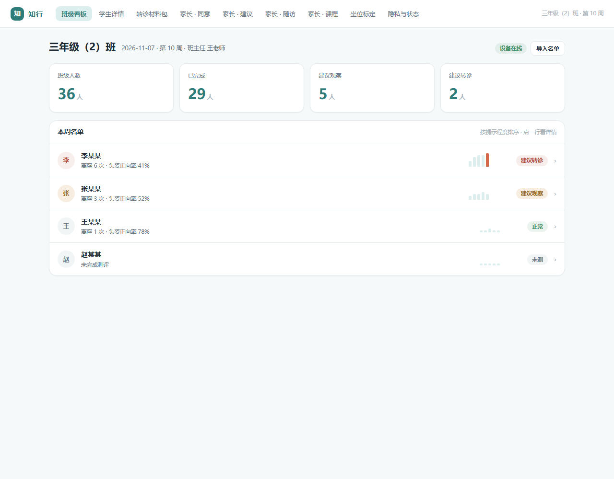
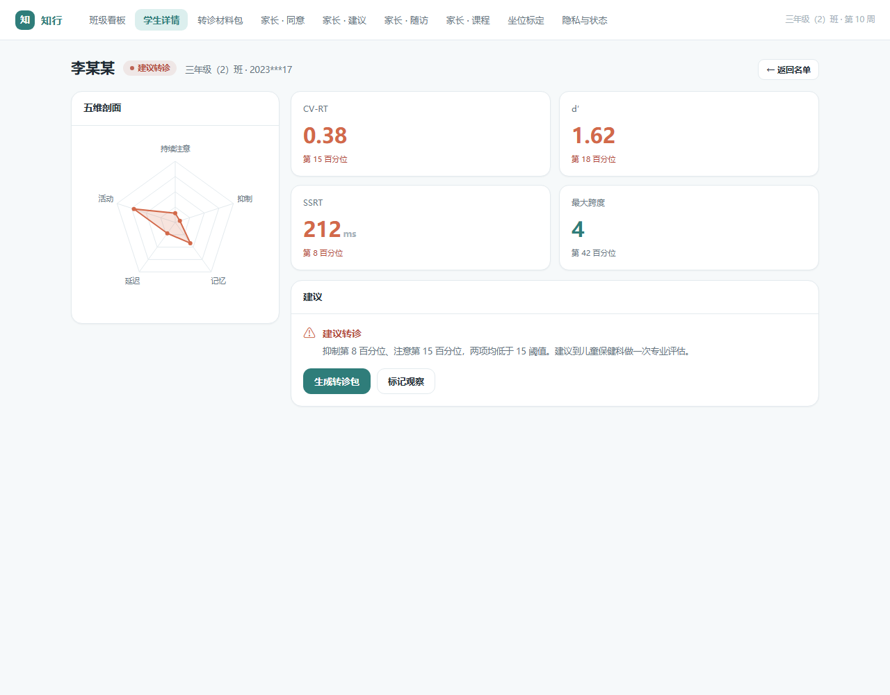

# 知行 · 儿童注意力与行为筛查

> 用每周一次的课堂摄像筛查缩小范围，再用 5 分钟小游戏把可疑孩子看仔细，
> 最后交给老师与医生做决定。

一个面向小学班主任与家长的**筛查**工具。系统只输出三档建议：

**正常 / 建议观察 / 建议转诊**

不做诊断、不开药、不做人脸识别、不上传视频。



---

## 解决什么问题

「坐不住、走神、冲动」的孩子在小学里并不少见，但老师不是医生，家长也不知道该不该去医院。

现实中的两个极端：要么被简单归结为「不听话」，要么被过度解读成「多动症」。
缺少的是一个中间环节——把课堂观察变成可讨论的东西，再由专业人员判断。

## 三个端

| 端 | 页面 | 回答的问题 |
|---|---|---|
| 教师端 | 班级看板 / 学生详情 / 转诊材料包 | 这周谁需要跟家长沟通 |
| 家长端 | 知情同意 / 孩子建议 / 随访打卡 / 家长微课 | 我的孩子怎么样、下一步做什么 |
| 摄像头端 | 坐位标定 / 隐私与状态 | 数据从哪来、会不会外泄 |



## 快速开始

双击 `index.html`。无需安装、无需联网。

接后端（可选，教师端会自动改用真实数据）：

```bash
python -m venv .venv
.venv\Scripts\activate
pip install fastapi uvicorn
python server/seed.py
python server/app.py
```

打开 <http://127.0.0.1:8770/zhixing>

## 三条产品红线

1. **只输出三档建议**，不出现「诊断」「患病」等表述；转诊材料页印有「仅作临床参考 · 不构成诊断依据」。
2. **不采集人脸、不上传视频、不做人脸识别**；摄像头的隐私开关是物理滑片，遮挡即断采。
3. **家长首次进入必须阅读并勾选知情同意**，未勾选时导出按钮不可用。

## 数据模型

`students` / `profiles` / `metrics` / `referrals` / `followups` / `cameras` / `camera_logs`

见 `server/seed.py`。换真实数据只改这个文件。

## 说明

- 演示数据为仿真生成，界面上有标注。
- 认知测评的四关游戏、摄像头的实际行为识别算法尚未实现，当前为界面与数据链路。
- 未成年人数据须监护人知情同意。

## 许可

MIT
